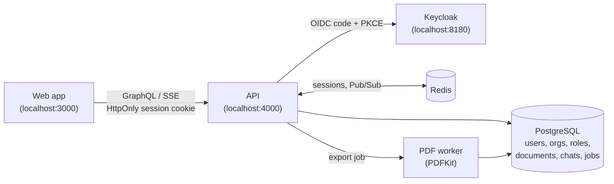

# LexBridge AI

**A multi-tenant legal knowledge assistant: ask questions against your firm's published documents, stream cited answers in real time, and export them as PDF.**

> **Prototype notice:** LexBridge is a portfolio prototype. All sample documents are synthetic, and the product does not provide legal advice.

---

## Table of contents

- [Overview](#overview)
- [Key features](#key-features)
- [Architecture](#architecture)
- [Tech stack](#tech-stack)
- [Getting started](#getting-started)
- [Configuration](#configuration)
- [Demo users](#demo-users)
- [Roles and permissions](#roles-and-permissions)
- [Security model](#security-model)
- [Testing and quality checks](#testing-and-quality-checks)
- [Guided demo](#guided-demo)
- [Design decisions](#design-decisions)

---

## Overview

A firm signs in through Keycloak, works inside one organization at a time, and asks questions against that organization's published documents. Answers are grounded in retrieved document chunks, streamed to the browser as they are generated, and can be exported as a PDF.

Tenant isolation, session handling, and role-based authorization are enforced server-side. The UI is never the only line of defense.

## Key features

- **Single sign-on with Keycloak** using OAuth 2.0 / OIDC Authorization Code with PKCE.
- **Strict multi-tenancy:** every tenant query is scoped to the active organization held on the server session.
- **Streaming answers:** chat output is delivered over SSE and survives reconnects.
- **Grounded responses:** answers are built from chunks retrieved from the organization's published documents.
- **Asynchronous PDF export:** the mutation returns a job id immediately; a separate worker renders the file.
- **Role-based access** (Admin, Editor, Reader) backed by PostgreSQL memberships.
- **Optional Google sign-in** via Keycloak identity brokering (disabled by default).
- **Works without an LLM key:** a deterministic mock grounded in retrieved chunks is used when none is configured.

## Architecture



### Authentication and sessions

- Keycloak authenticates users. **Application roles live in PostgreSQL**; Keycloak realm roles are not used for authorization.
- The API stores an opaque session id in Redis and sends it in an `HttpOnly`, `SameSite=Lax` cookie. The browser never stores access tokens or provider tokens.
- GraphQL mutations require the `x-lexbridge-request: 1` header. Login redirects accept only relative paths.

### Tenant isolation

Every tenant query is filtered by the active organization stored on the server session. A record belonging to another organization is returned as *not found*.

### Chat streaming

1. Generation publishes deltas on Redis Pub/Sub and writes the same text to PostgreSQL.
2. The SSE handler subscribes first, then sends the saved snapshot, then streams live deltas with sequence-number deduplication.
3. A client that reconnects mid-stream, or after completion, still receives the full answer.

### PDF export

Exporting returns a job id immediately. A separate worker renders the file with PDFKit and retries transient failures.

## Tech stack

| Concern | Technology |
| --- | --- |
| Identity | Keycloak (OIDC), `openid-client` |
| API | NestJS, GraphQL, SSE |
| Data | PostgreSQL (including full-text search) |
| Sessions and messaging | Redis (session store, Pub/Sub) |
| PDF rendering | PDFKit (dedicated worker) |
| Runtime and tooling | Node.js 22+, npm, Docker |

## Getting started

### Prerequisites

- Node.js 22 or later
- npm
- Docker

### Run locally

```bash
docker compose up -d postgres redis keycloak
cp .env.example .env
npm install
npm run db:migrate
npm run db:seed
npm run dev
```

| Service | URL | Notes |
| --- | --- | --- |
| Web | http://localhost:3000 | |
| API | http://localhost:4000 | |
| Keycloak | http://localhost:8180 | Admin credentials: `admin` / `admin` |

The Keycloak realm is named `lexbridge`.

> **Development tip:** `docker compose up` (with no service list) also builds the API, worker, and web images. For day-to-day development, run only Postgres, Redis, and Keycloak in Docker and run the Node processes on the host. This keeps the OIDC issuer at `http://localhost:8180`.

## Configuration

Copy `.env.example` to `.env` and adjust as needed.

| Variable | Purpose |
| --- | --- |
| `LLM_API_KEY` | Enables an OpenAI-compatible streaming model. If unset, the API uses a deterministic mock grounded in retrieved chunks. |

### Google sign-in (optional)

The imported realm includes a Google identity provider named `google`. It ships **disabled**, with placeholder credentials, so the demo has no dependency on Google.

To enable it:

1. Open the Keycloak admin console.
2. Set a real Google OAuth client id and secret on the `google` identity provider.
3. Enable the provider.

Google is used for brokering only. Organization roles continue to come from LexBridge memberships.

## Demo users

All demo users share the password `Lexbridge-demo-1`.

| User | Name | Organization | Role |
| --- | --- | --- | --- |
| alice | Alice Chen | Firm Alpha | Admin |
| bob | Bob Okonkwo | Firm Alpha | Editor |
| carol | Carol Nguyen | Firm Alpha | Reader |
| david | David Patel | Firm Beta | Admin |
| emma | Emma Rossi | Firm Beta | Reader |

Linking a Keycloak login to a seeded user requires `email_verified`. The demo users are imported with verified emails.

## Roles and permissions

| Capability | Reader | Editor | Admin |
| --- | :---: | :---: | :---: |
| Read published documents | ✓ | ✓ | ✓ |
| Ask questions | ✓ | ✓ | ✓ |
| Export own conversations | ✓ | ✓ | ✓ |
| Create and publish documents | | ✓ | ✓ |
| Invite users and change roles | | | ✓ |

Access to chats and exports is per user. An admin does **not** gain access to another user's chats or exports.

## Security model

| Control | Implementation |
| --- | --- |
| Authentication | OIDC Authorization Code + PKCE; issuer, audience, signature, expiry, and nonce validated by `openid-client` |
| Credential handling | No password form and no stored passwords; no tokens in the browser |
| Session | Opaque id in Redis, delivered in an `HttpOnly`, `SameSite=Lax` cookie; revoked on logout |
| CSRF mitigation | GraphQL mutations require the `x-lexbridge-request: 1` header |
| Open-redirect protection | Login redirects accept relative paths only |
| Authorization | Enforced in NestJS guards and services, not only in the UI |
| Tenant isolation | Active organization taken from the server session; cross-tenant records return *not found* |
| Account linking | Requires a verified email (`email_verified`) |

## Testing and quality checks

| Command | Description |
| --- | --- |
| `npm test` | Runs unit tests |
| `npm run test:integration` | Migrates the database and runs PostgreSQL and Redis integration tests |
| `npm run lint` | Lints the codebase |
| `npm run typecheck` | Runs the TypeScript type checker |
| `npm run build` | Builds all packages |

`lint`, `typecheck`, and `build` match the CI pipeline.

Security guarantees are covered by `apps/api/test/security.integration.spec.ts`, which verifies that:

- Firm Alpha cannot read a Firm Beta document.
- Logout revokes the session.
- Another user cannot download a PDF they do not own.

## Guided demo

A suggested five-minute walkthrough:

1. Sign in as **Alice** through Keycloak.
2. Open **Members**, confirm Bob is an editor and Carol is a reader, and create an invite link.
3. Sign in as **Carol** and confirm that publishing a document is rejected.
4. Sign in as **Alice** again, ask *"What notice period does the Harbor Services Agreement require?"*, and watch the answer stream.
5. Generate the PDF and download it.
6. Review `apps/api/test/security.integration.spec.ts` to see the tenant-isolation and session guarantees under test.

## Design decisions

- **OIDC over a custom login form.** The API validates issuer, audience, signature, expiry, and nonce with `openid-client` instead of handling passwords.
- **Server-side authorization.** Checks run in NestJS guards and services, so the API is safe independent of the UI.
- **PostgreSQL as the source of truth for chat.** Redis Pub/Sub is at-most-once, so the SSE handler replays the saved snapshot and ignores duplicate sequence numbers.
- **Queued PDF rendering.** Work is queued so the mutation returns before rendering finishes, and transient failures can be retried.
- **Swappable retrieval.** The retriever is an interface over PostgreSQL full-text search and can later be replaced with pgvector without changing chat delivery.